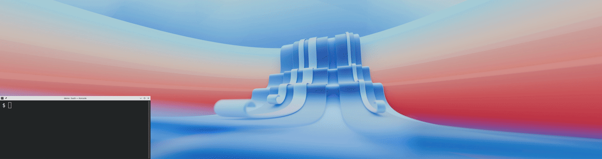

# kdoitall

**KDE Desktop Automation Tool**

[](https://github.com/CodeManEthan/kdoitall/actions/workflows/check.yml)



*`kdoitall workspace open demo` places five apps on their screens and tiles across a two-monitor desktop. The placement is shown at 4x speed.*

## About

kdoitall automates workspace management on KDE Plasma desktops. Define a workspace as a collection of applications, assign each one a screen, virtual desktop, and window position, then open and close the entire workspace with a single command. Individual windows can also be manipulated on-the-fly using `kdoitall quick` and the window commands, without needing to define a workspace.

It handles multi-screen and multi-desktop setups, keeps its state in SQLite, and finds installed applications from their `.desktop` files.

## How it works

1. **Scan.** `kdoitall app scan` reads the `.desktop` files in the standard application directories (see `DESKTOP_FILE_LOCATIONS` under [Configuration](#configuration)), skips the ones marked `NoDisplay=true`, and records each app's id and name. Apps whose `.desktop` file lists the `TerminalEmulator` category are marked as terminal emulators. Launch details kdoitall already knows, from the bundled app registry or an app definition under `lib/app-definitions/`, are filled in here.
2. **Define.** A workspace is a list of windows. Each window names an app, a virtual desktop, a screen and a position. `kdoitall workspace create <name>` asks for these one window at a time, or `--from-file` reads them from a JSON file (see [Workspace files](#workspace-files)). kdoitall stores the definition in its database and writes a small launch script for the workspace into its data directory (`~/.local/share/kdoitall/workspaces/`).
3. **Open.** `kdoitall workspace open <name>` runs that script. For each window it launches the app, waits for the new window to appear, moves it to its desktop and screen, sizes it to its position, and records it, so `close`, `focus`, `status` and the window commands can find it later. If an app allows only one instance and a window of it is already open, kdoitall reuses that window.

**Safe mode.** kdoitall needs to know an app's window class to find its window. The first time a workspace opens an app it hasn't profiled, it stops and lists those apps. You can accept, skip this time, turn the prompts off, or quit. If you accept, safe mode runs once per app. It launches the app on its own, then measures how long the window takes to appear and reads its window class. It also checks whether the process id identifies the window and picks a title pattern. Then it tests whether a second instance opens a new window (the launch mode), which can briefly open a second window, and notes any splash screen. It shows the results and asks you to accept, retry, skip, or pick a different title pattern. kdoitall stores accepted results and doesn't offer safe mode for that app again. A skipped app is offered again on the next open.

- `kdoitall workspace open --skip <name>` opens without asking.
- `SAFE_MODE_STRICTNESS` decides which apps count as unprofiled: `relaxed` (the default) means no known window class, `strict` also means an unknown launch mode or splash behaviour.
- `SAFE_MODE_PROMPTING="disabled"` turns the prompts off for good. The prompt's Disable option can set this for you.
- `kdoitall app safe-mode` runs safe mode outside a workspace; `app safe-mode skip <app_id>` and `app safe-mode reset <app_id>` mark an app done or clear its results.

## Key Features

- **Workspace management** — Create, open, close, and delete named workspaces with interactive configuration
- **Multi-screen and multi-desktop** — Place windows on specific screens and virtual desktops
- **28 window position presets** — 12 defaults (fullscreen, halves, thirds, and quadrants) plus 16 optional positions (two-thirds, 60/40, center, and quarter splits) enabled via `EXTRA_POSITIONS` config
- **Application registry** — Auto-detects installed applications from `.desktop` files via `app scan`
- **Custom launch functions** — Per-application launch behavior through the app-definitions system
- **Database-driven state** — SQLite-backed tracking of workspaces, applications, and window state

## Requirements

Tested on Fedora, Plasma 6, Wayland. X11 and Plasma 5 should work but are untested.

- **Desktop Environment:** KDE Plasma
- **Shell:** Bash 4.0+

### Dependencies

| Command          | Purpose                        |
|------------------|--------------------------------|
| `kdotool`        | KDE window management          |
| `kscreen-doctor` | Screen/display detection       |
| `sqlite3`        | Database operations            |
| `python3`        | Runs the database server (`lib/db/db-server.py`) |
| `jq`             | JSON parsing                   |
| `gtk-launch`     | Application launching          |

kdoitall checks for all six at startup and, if one is missing, names it with the install command for your package manager (dnf, apt, pacman or zypper).

> **Note:** `kdotool` is not available in standard package repos for most distributions. The install script can automatically download and install it for you, or you can install it manually from https://github.com/jinliu/kdotool

### Optional: the KWin snapshot daemon

| Needs                              | What for                                    |
|------------------------------------|---------------------------------------------|
| Python `dbus` and `gi` modules (python3-dbus, python3-gobject) | The daemon (`lib/kwin-scripts/daemon.py`) |
| `qdbus-qt6`                        | Talks to the daemon over the session bus    |

With these installed, kdoitall reads the window list through a KWin script that returns every window in one call. A small daemon on the session bus (`org.kdoitall.Snapshot`) carries the result back. kdoitall starts it on first use and it stays up for the session. Without them, kdoitall asks `kdotool` instead. That still works, but `kdotool` reports windows one by one, so a window that appears mid-query can be missed or cut short. `kdoitall --restart-snapshot-daemon` stops the daemon and starts a new one.

## Installation
```bash
git clone https://github.com/CodeManEthan/kdoitall.git
cd kdoitall
./scripts/install.sh
```

To uninstall:
```bash
./scripts/uninstall.sh
```

## Quick Start
```bash
# Scan for installed applications
kdoitall app scan

# Create a new workspace (interactive)
kdoitall workspace create my-workspace

# Open the workspace
kdoitall workspace open my-workspace

# Close the workspace
kdoitall workspace close my-workspace
```

<!-- sample: workspace open + status output, captured later -->

## Workspace files

A workspace can be written as JSON. This is `tests/fixtures/multi-window.json`, which the test suite imports:

```json
{
  "workspace": "test-multi-window",
  "description": "Test workspace with Kate and Dolphin on different desktops/screens",
  "focus_window": "test-mw-kate",
  "windows": [
    {
      "name": "test-mw-kate",
      "app": "org.kde.kate",
      "desktop": 9,
      "screen": "1",
      "position": "Left Half"
    },
    {
      "name": "test-mw-dolphin",
      "app": "org.kde.dolphin",
      "desktop": 8,
      "screen": "2",
      "position": "Right Half"
    }
  ]
}
```

`kdoitall workspace export <name>` prints this shape to stdout, and `kdoitall workspace create <name> --from-file <file>` reads it (add `--replace` to overwrite a workspace of that name). The name on the command line wins over the file's `workspace` field.

- `description` and `focus_window` are optional. `focus_window` names the window to bring to the front once the workspace is open.
- Each window `name` must be unique across all your workspaces.
- `app` is an app id from `kdoitall app list`. Run `kdoitall app scan` first, or the import refuses unknown apps.
- `desktop` must be a desktop that exists (1 up to your desktop count).
- `screen` is a screen number, an output name such as `DP-1`, or an alias set with `kdoitall screen alias`.
- `position` is one of the [positions](#positions).
- `function` and `params` are optional. Without them kdoitall starts the app through its `.desktop` file. `kdoitall app options <app_id>` lists the launch functions an app has and the values each takes. When a function takes several values, `params` holds them in one string separated by tabs (`\t` in JSON).

### Workspace files you didn't write

A workspace file can run commands. A window whose app is a terminal emulator can use one of the shared terminal functions, and those run what `params` says:

- `terminal_run_command_in_directory` opens a terminal, changes into the directory and runs the command.
- `terminal_launch_dev_server` changes into the directory, sources the virtualenv activate script if one is given, and runs the server command.
- `terminal_run_script` runs the script at the path given.

That is what these functions are for, and kdoitall does not ask before it runs them. kdoitall checks every value in a workspace file and passes it through as plain text, so a name or a path can't turn into a command. The commands and scripts these three functions run are a different matter, because running them is the point. So import only workspace files you trust, and read each window's `function` and `params` before you do.

## Positions

Positions are sized to the screen the window is on. The 12 defaults are always available. The 16 extras are off until you list them in `EXTRA_POSITIONS` (see [Configuration](#configuration)).

| Position          | Abbreviation | Set     |
|-------------------|--------------|---------|
| Fullscreen        | `fs`         | default |
| Right Half        | `rh`         | default |
| Left Half         | `lh`         | default |
| Top Half          | `th`         | default |
| Bottom Half       | `bh`         | default |
| Top Left          | `tl`         | default |
| Top Right         | `tr`         | default |
| Bottom Left       | `bl`         | default |
| Bottom Right      | `br`         | default |
| Left Third        | `lt`         | default |
| Middle Third      | `mt`         | default |
| Right Third       | `rt`         | default |
| Left Two-Thirds   | `l2t`        | extra   |
| Right Two-Thirds  | `r2t`        | extra   |
| Left 60           | `l60`        | extra   |
| Right 40          | `r40`        | extra   |
| Left 40           | `l40`        | extra   |
| Right 60          | `r60`        | extra   |
| Center Half       | `ch`         | extra   |
| Left 25           | `l25`        | extra   |
| Right 25          | `r25`        | extra   |
| Center Two-Thirds | `c2t`        | extra   |
| Top Two-Thirds    | `t2t`        | extra   |
| Bottom Two-Thirds | `b2t`        | extra   |
| Top 60            | `t60`        | extra   |
| Bottom 40         | `b40`        | extra   |
| Top 40            | `t40`        | extra   |
| Bottom 60         | `b60`        | extra   |

Wherever kdoitall asks for a position, you can give the name in any case (`left half`) or the lowercase abbreviation (`lh`). Workspace files, `add-window` and `edit-window` also take the constant name, such as `LEFTHALF`. In the interactive menus the extras are numbered after the defaults, in the order you list them.

## Usage
```
kdoitall [OPTIONS] <COMMAND> [ARGS...]
```

### Global Options
```
--help, -h                  Show help message
--version, -v               Show version
--info                      Show key milestones during execution
--verbose                   Enable verbose output
--restart-snapshot-daemon   Stop and respawn the KWin snapshot daemon
```

`--help` and `--version` print their text and exit before kdoitall checks its dependencies or opens its database, so they work on any Linux machine with bash. Every other command, subcommand help included, checks the dependencies first.

### Status & Update
```
status (st)      Show current state of active workspaces and windows
update           Update kdoitall (git pull + rebuild app registry)
```

### Quick Action (quick | q)

```
quick            Interactive window picker for ad-hoc actions
```

`kdoitall quick` lists every open window (KDE's own system windows left out) with its desktop, screen and position, whether or not a workspace opened it. Pick one by number, then pick an action: move to a desktop, a screen or a position, a combo move, focus, minimize or close.

A combo move takes desktop, screen and position in one line. A `.` keeps that value as it is, so `. 2 fs` leaves the window on its desktop and makes it fullscreen on screen 2. A session, with the window list left out:

```
$ kdoitall quick
Select window [1-5] (q to quit): 3
Select action [1-7] (b to go back, q to quit): 4
Enter combo: . 2 fs
```

### Workspace Commands (workspace | ws)

#### Main commands

```
create (new) <name>                   Create a new workspace interactively
list (ls) [--details]                 List all defined workspaces
info (i) <name>                       Show detailed info for a workspace
edit (e) <name>                       Edit an existing workspace (interactive)
open (o) [--skip] <name>              Open a workspace (--skip bypasses safe mode)
close (c) <name>                      Close a workspace
focus (f) <name>                      Focus an active workspace (raise + activate)
minimize (min) <name>                 Minimize all windows in an active workspace
delete (rm) <name>                    Delete a workspace
```

#### Non-interactive / scripted commands

```
create (new) <name>                    Create a workspace from a JSON config file
  --from-file <path>                     Path to JSON config (required)
  --replace                              Replace existing workspace
export (exp) <name>                    Export workspace definition to JSON (stdout)
edit (e) <name>                        Edit an existing workspace non-interactively
  --description "..."                    Set description
  --focus-window "name"                  Set focus window ("" to clear)
add-window (aw) <name>                 Add a window to a workspace
  --name, --app, --desktop, --screen, --position (required)
  --function, --params (optional)
edit-window (ew) <name> <window>       Edit a window definition
  --name, --desktop, --screen, --position, --function, --params, --display-order
remove-window (rw) <name> <window>     Remove a window from a workspace
```

### Application Commands (app)
```
scan                                  Scan system for available applications
list (ls) [filter]                    List applications (all, terminal, desktop, both)
info (i) <app_id|name>               Show detailed information about an application
validate                              Validate all application definition files
options (opts) <app_id>               Show launch options for an application
name (n) <app_id> <name>             Set a custom app name
name (n) reset <app_id>              Clear manual override (reverts to auto on next scan)
set-terminal (st) <app_id> [flag]    Mark app as terminal emulator (default exec flag: -e)
unset-terminal (ust) <app_id>        Remove terminal emulator classification
safe-mode (sm)                        Interactive safe-mode validation menu
safe-mode (sm) skip <app_id>         Mark app as validated (skip safe-mode)
safe-mode (sm) reset <app_id>        Clear safe-mode data for an app
```

### Screen Commands (screen | scr)
```
list (ls)                             List detected screens with aliases
alias <alias> <target>                Set a screen alias (target: number or name)
alias remove <alias>                  Remove a screen alias
```
### Window Commands (window | win)

```
list (ls) [workspace]                 List tracked windows
status (st) <window-name>             Show window details
close (c) <window-name>               Close a specific window
open (o) <window-name>                Re-open a previously closed window
focus (f) <window-name>               Bring window to front
minimize (min) <window-name>          Minimize window
```

#### move (mv) — reposition a window

```
move (mv) <window-name> [options]

Positional mode (order: desktop, screen, position):
  move <name> <desktop>
  move <name> <desktop> <screen>
  move <name> <desktop> <screen> <position>

Flag mode (any combination, any order):
  --desktop, -d <n>      Target virtual desktop
  --screen, -s <ref>     Target screen (number or alias)
  --position, -p <pos>   Window position preset
  --focus, -f            Focus the window after moving

Unspecified properties are preserved.
```

## Configuration

kdoitall reads its defaults from `config` in the project directory, then your own settings from `~/.config/kdoitall/config` (`$XDG_CONFIG_HOME/kdoitall/config` if you set that variable). The user file is a bash file. `scripts/install.sh` creates it with every setting below commented out, so uncomment a line to change it.

| Setting | Default | What it does |
|---|---|---|
| `SAFE_MODE_PROMPTING` | `"enabled"` | `"disabled"` stops `workspace open` from offering safe mode for unprofiled apps. |
| `SAFE_MODE_STRICTNESS` | `"relaxed"` | `"relaxed"` offers safe mode only when an app's window class is unknown. `"strict"` also offers it when the launch mode or splash behaviour is unknown. |
| `LOG_TO_FILE` | `"disabled"` | `"enabled"` writes the full verbose log of every run to a new file in `LOG_DIR`, whatever flags you pass. |
| `LOG_DIR` | `~/.local/state/kdoitall/logs` (under `$XDG_STATE_HOME` if set) | Where those log files go. |
| `CLOSE_WAIT_TIMEOUT` | `60` | Seconds `workspace close` waits for a window that didn't close at once (one showing a save dialog, say) before it skips that window. It brings the window to the front while it waits. |
| `EXTRA_POSITIONS` | not set | A bash array of extra [position](#positions) names to turn on, such as `EXTRA_POSITIONS=("Left Two-Thirds" "Right Two-Thirds")`. |
| `DESKTOP_FILE_LOCATIONS` | `/usr/share/applications`, `/usr/local/share/applications`, `~/.local/share/applications`, `/var/lib/flatpak/exports/share/applications`, `~/.local/share/flatpak/exports/share/applications`, `/var/lib/snapd/desktop/applications` | The directories `app scan` reads `.desktop` files from. |

To change `DESKTOP_FILE_LOCATIONS`, set it in your user file as a bash array. Your array replaces the whole default list, so include any default directories you still want scanned:

```bash
DESKTOP_FILE_LOCATIONS=(
    "/usr/share/applications"
    "$HOME/.local/share/applications"
    "$HOME/apps/desktop-files"
)
```

## Project Status

Maintained. Latest: v0.2.2.

kdoitall is usable for daily work, and it is still 0.x. Testing goes on to find and fix the edge cases in window detection and launching.

Current gaps:

- Limited metadata coverage in the app-registry database — most applications still require safe-mode to gather launch properties
- Application definitions only exist for VS Code and Firefox — other apps use generic launch behavior
- The integration tests need a live Plasma session, so CI runs only the static checks and unit tests (see [Testing](#testing))

## Testing

There are two suites.

The unit tests load kdoitall's library code and check it without KDE, a database or any windows. Run them anywhere:

```bash
bash tests/unit/run.sh
```

The integration suite is 16 files, `tests/test-01-*.sh` to `tests/test-16-*.sh`, run in order by:

```bash
tests/run-tests.sh
```

It drives real windows on your live Plasma session. It launches Kate, Dolphin, Firefox, VS Code, digiKam and System Settings, and moves them across desktops 5 to 9 and two screens. It needs those apps installed, at least nine virtual desktops and two screens. Leave the keyboard and mouse alone while it runs. If the environment checks in test-01 fail, the remaining files are skipped.

Each run uses its own data directory, a fresh database in a new `kdoitall-test-data.*` directory under `$TMPDIR` (or `/tmp`), deleted when the run ends. Your own database and workspace scripts are never read or written. Windows that were open before the run are left alone.

On every push and pull request, GitHub Actions (`.github/workflows/check.yml`) runs `bash -n` and `shellcheck` on every shell file, compiles the Python files, runs the unit tests, and checks that `--help` and `--version` work on a machine with no KDE tools.

## Documentation
In-depth architecture details, function maps, and change checklists live in the [`docs/`](docs/README.md) directory:

- [`docs/modules/`](docs/modules) — per-module references (database, window management, app registry, workspace, core engine, screen/desktop, safe mode)
- [`docs/flows/`](docs/flows) — end-to-end workflow guides (window launch pipeline, workspace open/close, app discovery, window detection)
- [`docs/checklists/`](docs/checklists) — step-by-step procedures for structural changes (adding an application, adding a command, modifying the database schema)

Database schema changes are applied automatically on each startup via forward-only migrations in [`database/migrations/`](database/migrations). See [`docs/modules/database.md`](docs/modules/database.md) for details.

## Contributing

Contributions are welcome. [CONTRIBUTING.md](CONTRIBUTING.md) holds the contributor agreement: your contributions are licensed under GPL-3.0-or-later, you keep your copyright, and you give the maintainer the right to relicense them under other open source licenses.

For a structural change, follow the matching checklist in [`docs/checklists/`](docs/checklists): [adding an application](docs/checklists/adding-an-application.md), [adding a command](docs/checklists/adding-a-command.md), or [modifying the database schema](docs/checklists/modifying-database-schema.md).

## License
```
kdoitall - KDE Desktop Automation Tool
Copyright (C) 2025 Ethan Plunk

Licensed under the GNU General Public License v3.0 or later (GPL-3.0-or-later).
See the LICENSE file for the full license text.
```
